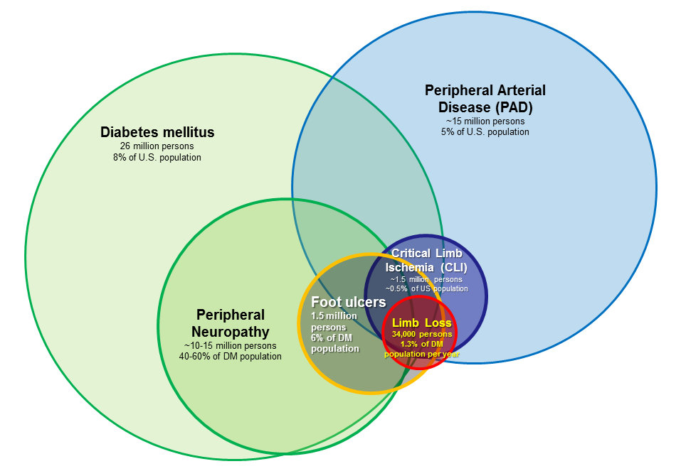

<figure class="tutorial-detail-figure">
  
  <figcaption>PAD and limb loss. Original figure from our <a href="/assets/documents/articles/barshes-dfu-systemofcare.pdf">2013 “System of Care” review paper</a>.</figcaption>
</figure>

Interdisciplinary care describes health care providers from multiple specialties that integrate and coordinate efforts into one shared treatment plan.

Interdisciplinary limb salvage is not about going solo or limiting the number of specialties that are involved in a given patient's care. Interdisciplinary care describes overlap between providers in different specialties rather than groups working in parallel or in separate "silos".

Patients seeing multiple specialists often have multiple (and sometimes discordant) treatment plans, one from each specialty team. Interdisciplinary care aims to avoid multiple or discordant plans.

Additionally, interdisciplinary limb salvage transitions from the traditional firm boundaries between the domains of specialties to overlapping capabilities across specialties. In limb salvage, providers outside of infectious diseases are able to initiate appropriate outpatient oral and inpatient parenteral regimens to initiate empiric antibiotic treatment of a foot ulcer with infection. Providers outside of vascular surgery are able to understand the significance of findings reported on non-invasive vascular testing. Providers outside of wound care or podiatry are able to select an appropriate wound care / dressing regimen and offloading footwear.

Our interdisciplinary approach began with frequent communication between specialties, first to discuss the treatment plans of individual patients, then to more generally discuss treatment strategies and preferences. We consolidated our own specialty and clinic-specific management protocols, then shared with teams in other specialties. To do this, we taught each other some of the aforementioned basics within our respective specialties. In doing so, comprehensive care can be initiated when a limb salvage patient is seen in any of our specialty clinics, then refined as more specialty teams get involved.
